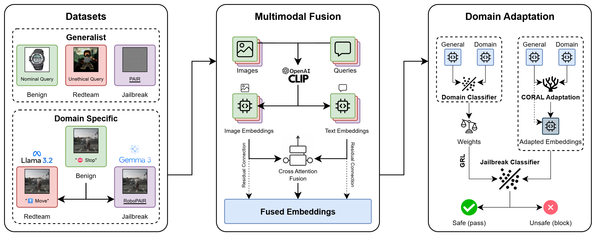

<div id="top"></div>
<!-- PROJECT LOGO -->
<br />
<div align="center">
  <a href="https://github.com/Mhackiori/J-DAPT">
    
  </a>

  <h1 align="center">J-DAPT</h1>

  <p align="center">Jailbreaking Prevention in VLMs Through
Multimodal Domain Adaptation
    <br />
    <a href="https://github.com/Mhackiori/J-DAPT"><strong>Paper accepted at ICRA 2026 »</strong></a>
    <br />
    <br />
    Francesco Marchiori, Rohan Sinha, Christopher Agia, Alexander Robey, George J. Pappas, Mauro Conti, Marco Pavone
  </p>
</div>

<!-- TABLE OF CONTENTS -->
<details>
  <summary><strong>Table of Contents</strong></summary>
  <ol>
    <li>
      <a href="#abstract">Abstract</a>
    </li>
    <li>
      <a href="#overview">Overview</a>
    </li>
    <li>
      <a href="#usage">Usage</a>
      <ul>
        <li><a href="#installation">Installation</a></li>
        <li><a href="#datasets">Datasets</a></li>
        <li><a href="#preprocessing">Preprocessing</a></li>
        <li><a href="#jailbreaking">Jailbreaking</a></li>
        <li><a href="#embeddings">Embeddings</a></li>
        <li><a href="#methodology">Methodology</a></li>
        <li><a href="#overhead">Overhead</a></li>
      </ul>
    </li>
    <li>
      <a href="#citation">Citation</a>
    </li>
  </ol>
</details>


<div id="abstract"></div>

## 🧩 Abstract

>Large Language Models (LLMs) and Vision-Language Models (VLMs) are increasingly deployed in robotic environments but remain vulnerable to jailbreaking attacks that bypass safety mechanisms and drive unsafe or physically harmful behaviors in the real world. Data-driven defenses such as jailbreak classifiers show promise, yet they struggle to generalize in domains where specialized datasets are scarce, limiting their effectiveness in robotics and other safety-critical contexts. To address this gap, we introduce J-DAPT, a lightweight framework for multimodal jailbreak detection through attention-based fusion and domain adaptation. J-DAPT integrates textual and visual embeddings to capture both semantic intent and environmental grounding, while aligning general-purpose jailbreak datasets with domain-specific reference data. Evaluations across autonomous driving, maritime robotics, and quadruped navigation show that J-DAPT boosts detection accuracy to very high levels (up to 100% in certain scenarios) under our evaluation protocol. These results demonstrate that J-DAPT provides a practical defense for securing VLMs in robotic applications.

<p align="right"><a href="#top">(back to top)</a></p>
<div id="overview"></div>

## 🔎 Overview



<p align="right"><a href="#top">(back to top)</a></p>
<div id="usage"></div>

## ⚙️ Usage

First, start by cloning the repository.

```bash
git clone https://github.com/Mhackiori/J-DAPT.git
cd J-DAPT
```

<div id="installation"></div>

### ⬇️ Installation

Install the required Python packages by running:

```bash
pip install -r requirements.txt
```

We recommend creating a dedicated environment to avoid package version collisions. If you use Conda, you can run the following:

```bash
conda create -n jdapt python=3.10
conda activate jdapt
pip install -r requirements.txt
```

Or, you can import directly from the `yml` environment file:

```bash
conda env create -f assets/environment.yml
conda activate jdapt
```

<div id="datasets"></div>

### 🖼️ Datasets

Please refer to the datasets used in the paper and obtain them from their original sources.

General-purpose datasets:

- **DAQUAR**: Malinowski and Fritz, *A Multi-World Approach to Question Answering About Real-World Scenes Based on Uncertain Input* (NeurIPS 2014).
- **JB28K / JailBreakV**: Luo et al., *JailBreakV: A Benchmark for Assessing the Robustness of Multimodal Large Language Models Against Jailbreak Attacks* (arXiv 2024).

Domain-specific datasets:

- **LingoQA**: Marcu et al., *LingoQA: Visual Question Answering for Autonomous Driving* (ECCV 2024).
- **nuScenes**: Caesar et al., *nuScenes: A Multimodal Dataset for Autonomous Driving* (CVPR 2020).
- **ABOships-PLUS**: Iancu et al., *A Benchmark for Maritime Object Detection with CenterNet on an Improved Dataset, ABOships-PLUS* (JMSE 2023).
- **LaRS**: Zust et al., *LaRS: A Diverse Panoptic Maritime Obstacle Detection Dataset and Benchmark* (ICCV 2023).

Once the datasets are downloaded, place them under the directory configured by `dataset_folder` in [`utils/params.py`](https://github.com/Mhackiori/J-DAPT/blob/main/utils/params.py).

<div id="preprocessing"></div>

### 🔨 Preprocessing

Once datasets have been downloaded, you need to process them in order to:

1. Process videos from raw images;
2. Generate nominal (benign) queries for each scenario;
3. Generate **goals** and **targets** for RoboPAIR.

To generate prompts, we use local _Ollama_ models, as they can process the entire image sequences. If you have a Linux-based system, you can install it by running:

```bash
curl -fsSL https://ollama.com/install.sh | sh
```

We will then use `gemma3:27b` to process the videos and `llama3.2` to generate redteam queries. You will need 20 more GB for the models. You can pull them by running:

```bash
ollama pull gemma3:27b
ollama pull llama3.2
```

After this, you can run the preprocessing script:

```bash
python preprocessing.py
```

<div id="jailbreaking"></div>

### ⚔️ Jailbreaking

After preprocessing, domain-specific datasets that will used for jailbreaking detection have both a benign query and a goal and target for generating the jailbreaking prompt. We use [RoboPAIR](https://github.com/arobey1/robopair) to generate them. You can add it in the repository as a Git module, but since we have made some modifications to the code to adapt to our framework, we already included it in this repository. First, export your OpenAI API key:

```bash
export OPENAI_API_KEY=<your_openai_key>
```

The script uses `wandb`, so you will need to either login or to disable sync by running `wandb offline`. Then, you can start generating the jailbreaks by running:

```bash
bash jailbreak.sh
```

<div id="embeddings"></div>

### 🏷️ Embeddings

All user inputs (benign, redteaming, and jailbreaks) and image sequences are now ready. Our classification is performed at the embeddings level, so we use [CLIP](https://huggingface.co/openai/clip-vit-base-patch32) to process them. You can do this by running:

```bash
python embeddings.py
```

Running this script will also train out multimodal fusion model, which will be saved in [`models`](https://github.com/Mhackiori/J-DAPT/tree/main/models). Also, by default, the script generates the embeddings for each of the models we use for our analysis.

<div id="methodology"></div>

### 💡 Methodology

The embeddings that the previous script has produced contain text, image, and fused embeddings with our multimodal fusion model. The full methodology, classifier training, and evaluation of our methodology is represented separately in the three Jupyter notebooks: [`jdapt-car.ipynb`](https://github.com/Mhackiori/J-DAPT/blob/main/jdapt-car.ipynb), [`jdapt-boat.ipynb`](https://github.com/Mhackiori/J-DAPT/blob/main/jdapt-boat.ipynb), and [`jdapt-robodog.ipynb`](https://github.com/Mhackiori/J-DAPT/blob/main/jdapt-robodog.ipynb).

<div id="overhead"></div>

### ⏱️ Overhead

We perform a comparison of J-DAPT with the usage of a dedicated LLM that has the same input as the target VLM, but is tasked on recognizing whether the input represents a jailbreak attempt or not. For the sake of this analysis, we will use also different models of the Gemma 3 and Qwen 2.5 VL family:

```bash
ollama pull qwen2.5vl:3b
ollama pull qwen2.5vl:7b
ollama pull qwen2.5vl:32b
ollama pull gemma3:4b
ollama pull gemma3:12b
ollama pull gemma3:27b
```

Then, we run the script:

```bash
python overhead.py
```

This will generate `csv` files inside the [`results`](https://github.com/Mhackiori/J-DAPT/tree/main/results) folder.

<p align="right"><a href="#top">(back to top)</a></p>
<div id="citation"></div>

## 🗣️ Citation

Please, cite this work when citing the preprint:

```
@misc{marchiori2025preventingroboticjailbreakingmultimodal,
      title={Preventing Robotic Jailbreaking via Multimodal Domain Adaptation}, 
      author={Francesco Marchiori and Rohan Sinha and Christopher Agia and Alexander Robey and George J. Pappas and Mauro Conti and Marco Pavone},
      year={2025},
      eprint={2509.23281},
      archivePrefix={arXiv},
      primaryClass={cs.RO},
      url={https://arxiv.org/abs/2509.23281}, 
}
```

<p align="right"><a href="#top">(back to top)</a></p>
